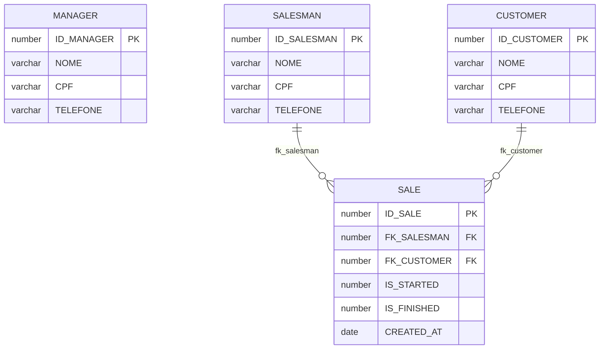
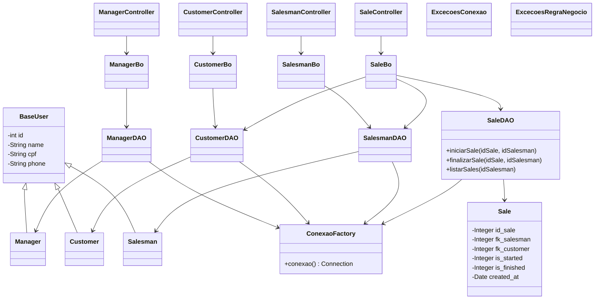

# Documentação do Projeto

**Faculdade:** FIAP  
**Disciplina:** Java  
**Nome da solução:** Gestão de Vendas  
**Nome da equipe:** Equipe Gestão de Vendas

## Integrantes

| Nome | RM |
|---|---|
| João Vitor Piccolo | 565127 |
| Gabrielle Calazans | 564460 |
| Jéssica Domingues | 562973 |
| Kauã Carvalho | 566371 |
| Leonardo Pereira | 561349 |

---

## Sumário

1. [Objetivo e escopo do projeto](#1-objetivo-e-escopo-do-projeto)
2. [Principais funcionalidades](#2-principais-funcionalidades)
3. [Protótipo](#3-protótipo)
4. [Modelo do banco de dados](#4-modelo-do-banco-de-dados)
5. [Diagrama de classes](#5-diagrama-de-classes)

---

## 1. Objetivo e escopo do projeto

O projeto é uma API REST para controlar o cadastro de pessoas e o ciclo de uma venda.

O gerente cadastra e altera vendedores, clientes e vendas. O vendedor consulta as vendas dele e muda o estado da venda (iniciar ou finalizar).

O que entra no escopo:

- CRUD de manager, salesman, customer e sale
- Busca de vendedor por nome
- Listagem de vendas por vendedor
- Regras de inicio e fim da venda
- Persistência no Oracle da FIAP com JDBC

O que fica de fora:

- Tela web pronta (o front consome a API)
- Login com senha / token
- Pagamento, estoque ou produto

---

## 2. Principais funcionalidades

**Cadastro de pessoas**  
Manager, salesman e customer usam os mesmos dados: nome, CPF e telefone. Dá para listar, buscar por id, criar, atualizar e apagar.

**Cadastro de venda**  
A venda liga um vendedor a um cliente. Na criação ela nasce com `IS_STARTED = 0`, `IS_FINISHED = 0` e a data do dia. O vendedor e o cliente precisam existir.

**Fluxo do vendedor**  
O vendedor é encontrado pelo nome (`GET /salesman/nome/{nome}`), lista as vendas dele e inicia ou finaliza uma sale.

Regras que o service valida:

- nome, CPF e telefone não podem ficar vazios
- venda só é criada/alterada se salesman e customer existirem
- não dá para marcar uma venda como finalizada se ela ainda não foi iniciada
- iniciar só vale se a sale estiver `0/0`
- finalizar só vale se estiver `1/0`
- se já estiver finalizada, não muda mais

---

## 3. Protótipo

A entrega atual é a API. As “telas” abaixo são os fluxos que o front deve seguir. A base é `http://localhost:8080`.

### 3.1 Tela do gerente

O gerente entra e escolhe o que vai mexer: vendedor, cliente ou venda.

```
+----------------------------------+
|            GERENTE               |
|                                  |
|  [ Vendedores ]  [ Clientes ]    |
|  [ Vendas ]                      |
+----------------------------------+
```

Em cada opção aparece o CRUD:

```
+----------------------------------+
|  Vendedores / Clientes / Vendas  |
|                                  |
|  1. Cadastrar                    |
|  2. Buscar por ID                |
|  3. Listar todos                 |
|  4. Atualizar                    |
|  5. Excluir                      |
+----------------------------------+
```

Como usar na API:

1. **Listar** — `GET /salesman`, `GET /customer` ou `GET /sale`
2. **Buscar** — `GET /salesman/{id}` (o mesmo vale para customer e sale)
3. **Cadastrar vendedor ou cliente** — `POST` com JSON:

```json
{
  "name": "Renato",
  "cpf": "12345678900",
  "phone": "11999999999"
}
```

4. **Cadastrar venda** — `POST /sale` com o id do vendedor e do cliente:

```json
{
  "fk_salesman": 1,
  "fk_customer": 1
}
```

A API preenche sozinha `is_started`, `is_finished` e `created_at`.

5. **Atualizar** — `PUT /salesman`, `PUT /customer` ou `PUT /sale` mandando o objeto com o `id`
6. **Excluir** — `DELETE /salesman/{id}` (o mesmo para os outros)

Se o nome/CPF/telefone vier vazio, a API recusa. Se a venda apontar para um vendedor ou cliente que não existe, também recusa.

### 3.2 Tela do vendedor

O vendedor não cadastra nada. Ele se identifica pelo nome, vê as sales dele e inicia/finaliza.

```
+----------------------------------+
|            VENDEDOR              |
|                                  |
|  Nome: ________________          |
|                                  |
|  [ Entrar ]                      |
+----------------------------------+
```

Chamada: `GET /salesman/nome/Renato`

Se vier mais de um com o mesmo nome, o front mostra a lista e a pessoa escolhe o id.

```
+----------------------------------+
|  Vendedor: Renato (ID 1)         |
|                                  |
|  Sale 1 | cliente 1 | aberta     |
|  Sale 3 | cliente 2 | iniciada   |
|                                  |
|  ID da sale: ____                |
|  [ Iniciar / Finalizar ]         |
+----------------------------------+
```

- Lista as sales: `GET /sale/salesman/{idSalesman}`
- Iniciar: `PUT /sale/{id}/iniciar/{idSalesman}`
- Finalizar: `PUT /sale/{id}/finalizar/{idSalesman}`

Ordem esperada: aberta (`0/0`) -> iniciada (`1/0`) -> finalizada (`1/1`).  
Tentar finalizar sem ter iniciado, ou iniciar de novo depois de finalizar, cai na regra de negócio.

### 3.3 Exemplo rápido no terminal

```bash
# lista clientes
curl http://localhost:8080/customer

# cria cliente
curl -X POST http://localhost:8080/customer \
  -H "Content-Type: application/json" \
  -d '{"name":"Maria","cpf":"00011122233","phone":"11988887777"}'

# inicia a sale 1 do vendedor 1
curl -X PUT http://localhost:8080/sale/1/iniciar/1
```

---

## 4. Modelo do banco de dados

Banco: Oracle FIAP (`oracle.fiap.com.br:1521:orcl`).  
As tabelas já usadas no projeto:



`IS_STARTED` e `IS_FINISHED` são `0` ou `1`.

O manager não entra como FK na sale. Ele só administra os cadastros.

---

## 5. Diagrama de classes

Camadas iguais às usadas em sala: Entity, DAO, Bo (regras) e Controller (REST).



O controller instancia o Bo, o Bo instancia o DAO e o DAO abre a conexão no construtor.  
As regras (campo vazio, FK, estado da sale) ficam no Bo. O DAO só roda o SQL.
